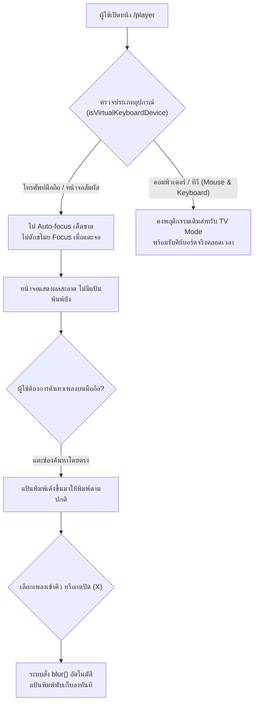

# แผนแก้ไขปัญหา On-Screen Keyboard เด้งรบกวนบนมือถือในหน้า `/player`

## 1. สาเหตุของปัญหา (Root Cause Analysis)

หน้า `/player` (`https://karaoke-hub-nu.vercel.app/player`) ถูกออกแบบหลักมาเพื่อเป็น **TV Kiosk Mode / Karaoke Stage** สำหรับใช้งานบนจอทีวีหรือคอมพิวเตอร์ โดยมีฟีเจอร์ให้กดพิมพ์ค้นหาเพลงด้วยคีย์บอร์ดจริง (Hardware Keyboard) ได้ทันทีโดยไม่ต้องคลิกเมาส์

ในคอมโพเนนต์ [`PlayerSearchOverlay.tsx`](file:///d:/karaoke/src/components/PlayerSearchOverlay.tsx) จึงมีการเขียนคำสั่งบังคับ Focus ไปที่ `<input ref={inputRef}>` อย่างต่อเนื่อง:

1. **Auto-focus ตอนโหลดหน้าเว็บ (Mount):** ใน `useEffect` มีการเรียก `focusSearchInput()` ทันทีที่เปิดหน้า
2. **ขโมย Focus กลับทุกครั้งที่แตะหน้าจอ (`recaptureFocusAfterPointer`):** ดักฟัง Event `click` ระดับ `document` ทั่วทั้งหน้าจอ เมื่อแตะที่ใดก็ตาม (เช่น แตะวิดีโอ, แตะปรับเสียง, แตะปุ่มเต็มจอ, แตะ QR Code) จะสั่ง `focusSearchInput()` ซ้ำทันที
3. **ขโมย Focus กลับเมื่อหน้าต่าง Blur (`recaptureFocusFromPlayer`):** เมื่อกดซ่อนแป้นพิมพ์หรือกดสลับหน้าต่าง จะสั่ง `focusSearchInput()` ซ้ำทันที
4. **Focus แม้กระทั่งขณะกำลังเล่นเพลง:** ในขณะเล่นเพลง กล่องค้นหาจะถูกย่อเหลือ `1px x 1px` ซ่อนไว้มุมจอ แต่คำสั่ง Focus ยังคงทำงานอยู่ตลอดเวลา

### ทำไมถึงเกิดปัญหารุนแรงบนโทรศัพท์มือถือ?
บนสมาร์ตโฟน (iOS Safari, Android Chrome):
- เมื่อ element ประเภท `<input>` ได้รับ Focus ผ่านคำสั่ง JavaScript `.focus()` ระบบปฏิบัติการมือถือจะมองว่าผู้ใช้ต้องการพิมพ์ จึง **เด้ง Virtual Keyboard (On-Screen Keyboard) ขึ้นมาบดบังหน้าจอ 50–70% ทันที**
- เมื่อผู้ใช้พยายามแตะหน้าจอเพื่อดูวิดีโอ หรือพยายามกดปุ่มปิดแป้นพิมพ์ ตัวดักฟัง `click` และ `blur` จะทำงานและสั่ง `.focus()` ซ้ำอีกรอบ ทำให้ **แป้นพิมพ์เด้งกลับขึ้นมาใหม่วนซ้ำไม่รู้จบ (Keyboard Loop)**

---

## 2. แผนการจัดการและแก้ไข (Proposed Solution)

### ขั้นที่ 1: เพิ่มฟังก์ชันตรวจจับอุปกรณ์หน้าจอสัมผัส/คีย์บอร์ดเสมือน
สร้างฟังก์ชัน `isVirtualKeyboardDevice()` ใน [`src/lib/player-keyboard.ts`](file:///d:/karaoke/src/lib/player-keyboard.ts):
- ตรวจสอบ `window.matchMedia('(pointer: coarse)')` (ใช้นิ้วสัมผัสเป็นหลัก)
- ตรวจสอบ `(hover: none)` ร่วมกับ Touch capability (`navigator.maxTouchPoints > 0` หรือ `'ontouchstart' in window`)
- ตรวจสอบ Mobile User Agent (iOS / Android) เพื่อรองรับอย่างครอบคลุม
- ปลอดภัยต่อ SSR (Server-Side Rendering)

### ขั้นที่ 2: ปรับปรุงตรรกะใน `PlayerSearchOverlay.tsx`
1. **ระงับการ Auto-focus บนมือถือ:**
   - ภายใน `focusSearchInput`: หากเป็นอุปกรณ์คีย์บอร์ดเสมือน (`isVirtualKeyboardDevice() === true`) ให้หยุดการทำงานทันที
   - ภายใน `useEffect` ของ `recaptureFocusAfterPointer` และ `recaptureFocusFromPlayer`: ยกเลิกการผูก Event Listener บนอุปกรณ์สัมผัส ทำให้ผู้ใช้แตะหน้าจอ, ปรับเสียง, หรือกดดูเต็มจอได้โดยไม่มีแป้นพิมพ์เด้งขึ้นมา
2. **สั่ง Blur ปิดแป้นพิมพ์อัตโนมัติเมื่อเลิกใช้งาน:**
   - ใน `closeSearch()` และ `closeQueueBrowser()`: หากเป็นมือถือ ให้สั่ง `inputRef.current?.blur()` เพื่อให้แป้นพิมพ์พับเก็บทันที
   - เมื่อผู้ใช้แตะเลือกเพลงลงคิวสำเร็จ (`addSelectedVideo`) แป้นพิมพ์จะพับเก็บลงทันที
3. **เพิ่มปุ่มล้าง/ปิดค้นหา (Clear & Close Button):**
   - เพิ่มปุ่มกากบาท `X` ในแถบค้นหาเมื่อมีข้อความ (`query.length > 0`) เพื่อให้ผู้ใช้มือถือสามารถล้างข้อความและปิดช่องค้นหาได้ในแตะเดียว (ไม่ต้องกด Backspace ทีละตัว หรือกดปุ่ม Escape ที่ไม่มีบนแป้นพิมพ์มือถือ)
   - เพิ่มปุ่ม "ปิดค้นหา" บนหน้าจอมือถือในส่วนผลการค้นหา

### ขั้นที่ 3: ป้องกัน Focus คืนใน `LyricsGoogleSearchModal.tsx`
- ใน `LyricsGoogleSearchModal.tsx` ป้องกันการคืน Focus กลับไปยัง input หากเป็นอุปกรณ์มือถือเมื่อปิดหน้าต่างค้นหาเนื้อเพลง

### ขั้นที่ 4: เพิ่มชุดทดสอบ Unit Tests
- เพิ่มการทดสอบใน [`tests/player-state.test.cjs`](file:///d:/karaoke/tests/player-state.test.cjs) เพื่อยืนยันว่า:
  - `isVirtualKeyboardDevice()` ตรวจจับโหมดมือถือและโหมดเดสก์ท็อปได้อย่างถูกต้อง
  - ฟังก์ชันปุ่มลัดคีย์บอร์ดเดิมบน PC/TV ยังคงทำงานได้สมบูรณ์ 100%

---

## 3. ผลลัพธ์ที่ได้หลังแก้ไข
1. **บนมือถือ (Smartphones/Tablets):**
   - เมื่อเปิดหน้า `https://karaoke-hub-nu.vercel.app/player` จะไม่มีแป้นพิมพ์เด้งขึ้นมากวนใจอีกต่อไป
   - วิดีโอเล่นได้เต็มจอ แตะหน้าจอเพื่อเปิดเต็มจอ, เปิดดู QR Code, ปรับระดับเสียง หรือกดร้องคาราโอเกะได้อย่างราบรื่น
   - หากต้องการค้นหาเพลง สามารถแตะที่ช่องค้นหาได้ตามปกติ แป้นพิมพ์จะขึ้นมาเฉพาะตอนที่แตะ และจะพับเก็บลงทันทีเมื่อเลือกเพลงหรือปิดค้นหา
2. **บน PC / Smart TV / TV Box:**
   - ยังคงทำงานในรูปแบบ Kiosk Mode สำหรับร้าน/ปาร์ตี้เหมือนเดิม พิมพ์ค้นหาด้วยคีย์บอร์ดจริงได้ทันทีโดยไม่เสียความสามารถเดิม

## Execution

- User-supplied plan approved for implementation by the request to carry it out.
- Work remains in the existing isolated feature worktree; source files are clean at `76381ae`.
- Implement device detection, automatic-focus guards, explicit close/blur controls, modal focus restoration, and behavioral tests.
- Preserve real hardware keyboard input on touch devices/TVs: an actual printable key can explicitly focus search, while mount/click/blur cannot.
- Verify device classification, component focus/blur/listener behavior, existing shortcuts, TypeScript, lint and build; use a final independent review.
- Final review found that touch-only users need a visible search opener while playback hides the empty input. Added an explicit opener that reveals search without focusing; users then tap the field. Regression covers reopening after both closing and song selection.
- Closed lyrics portals now set aria-modal=false, so the existing desktop focus guard does not treat a hidden Google-results portal as an active dialog.
- Clear/close controls are available on all screen sizes, including touch tablets with wide viewports. Desktop automatic focus and real-key shortcuts remain unchanged.
- Final verification: 144 tests passed; production build and targeted ESLint passed. One pre-existing unused eslint-disable warning remains in player-state.test.cjs.
- Mobile focus and device signals are tested using component/browser mocks; native iOS/Android software-keyboard rendering is not exercised by the desktop browser viewport check.
